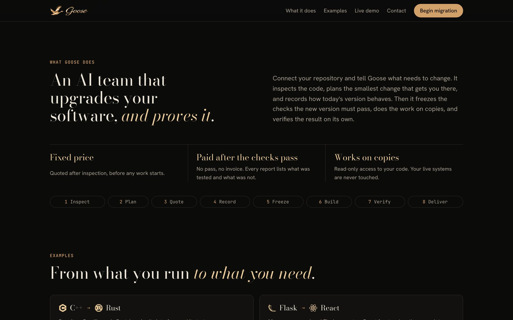
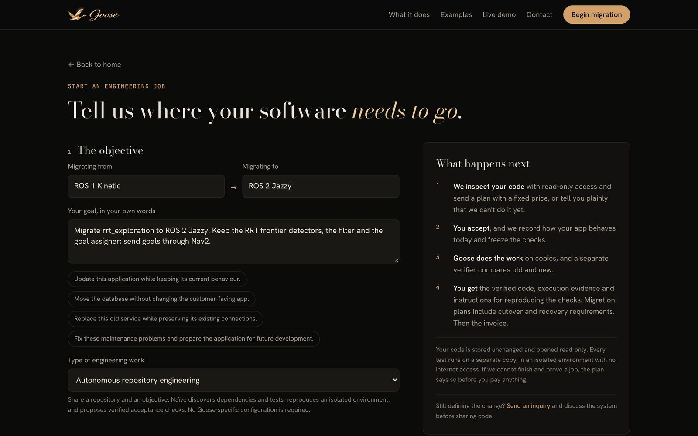
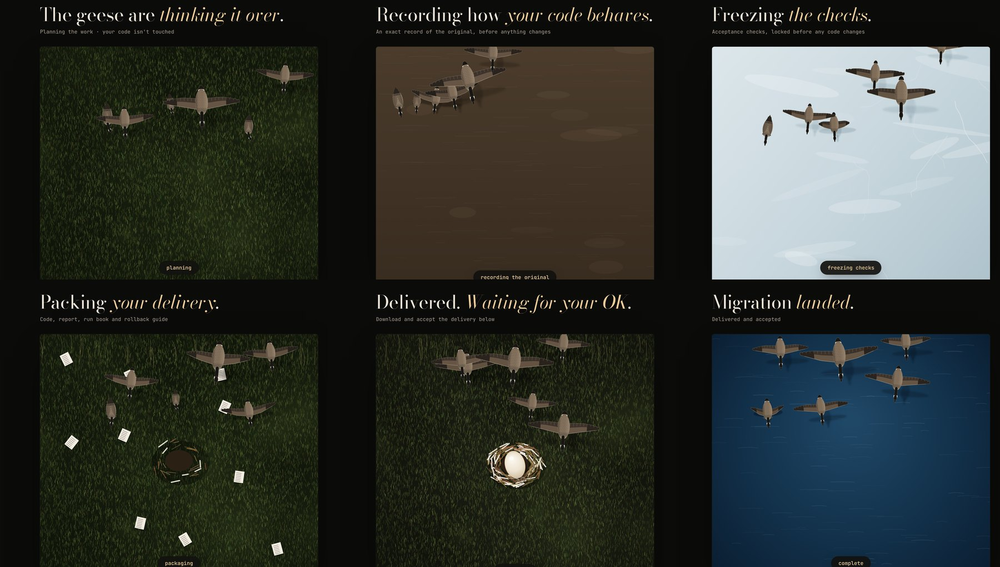
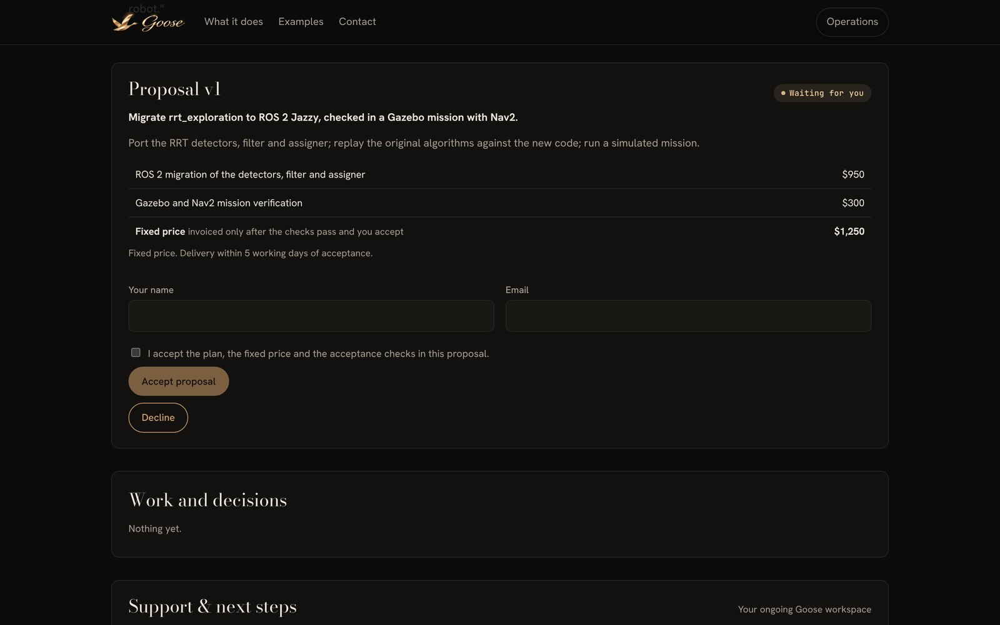
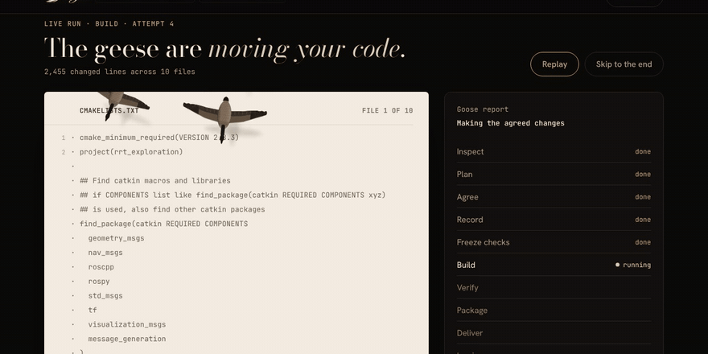
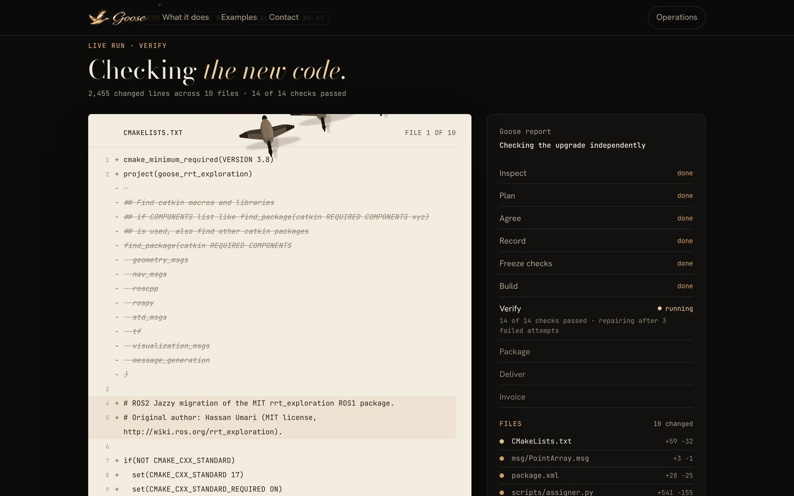
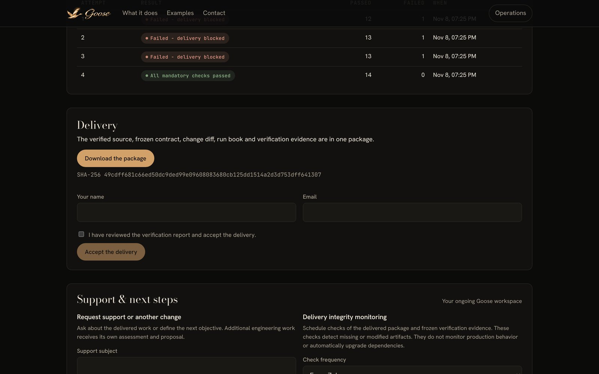
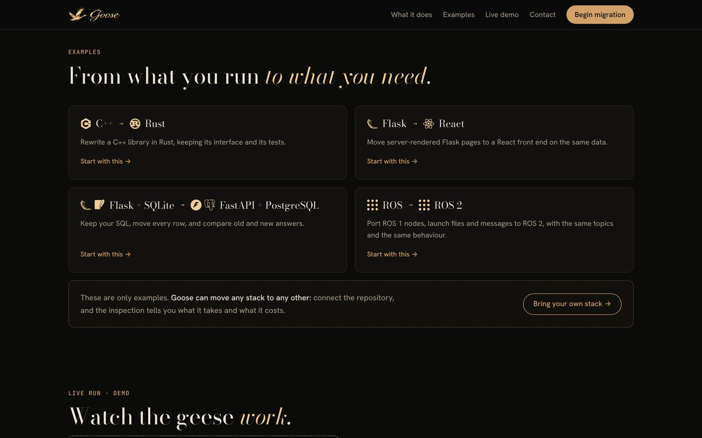

<p align="center"></p>

<p align="center">
  <a href="https://youtu.be/IY0WQeiUPFs"></a>
</p>

<p align="center"><b>An autonomous engineering company that moves your old code to a modern stack,<br>proves nothing broke, and only bills you when the checks pass.</b><br>
<a href="https://youtu.be/IY0WQeiUPFs">▶ Watch the demo video</a></p>

Built for the [Naïve Autonomous Companies Hackathon](https://events.ycombinator.com/naive-autonomous-companies-hackathon) (Y Combinator, November 2026).

---

## The problem

Software never stops moving, but the code companies run on does. Frameworks reach end of life, databases get outgrown, and languages fall out of favour. **ROS 1, the robotics framework much of the industry was built on, [reached end of life on May 31, 2025](https://discourse.openrobotics.org/t/ros-noetic-end-of-life-may-31-2025/43160)**, and Python 2, Django 2 and Flask 1 apps are still in production everywhere.

The cost is large: enterprises spend an estimated **$56 million a year on average** just maintaining, updating and integrating legacy systems, and more than nine in ten depend on legacy applications every day ([Pega research, 2025](https://www.businesswire.com/news/home/20251014412055/en/Average-Global-Enterprise-Wastes-More-Than-370-Million-Every-Year-Through-Technical-Debt-Says-Research)).

Teams put migrations off for one reason: **nobody can prove the new version behaves exactly like the old one.**

## What Goose does

Goose is a company run almost entirely by AI agents, with a founder handling exceptions. You give it a repository and the outcome you need. Its agents inspect the code, plan the change, agree a fixed price with you, **record how your current software behaves, freeze the checks the new version must pass**, do the work on copies, and verify the result independently. You get the migrated code, the full test report and a rollback guide. No pass, no invoice.

<p align="center"></p>

## Meet the team

Every role in the company is an agent running on Naïve, each with a budget, a typed output and a record of every decision it made.

| | Agent | Role | What it does |
|:-:|---|---|---|
|  | **Seacher** | Researcher | Finds public projects running on end-of-life software, with evidence |
|  | **Reacher** | Outreach | Writes and sends a short, specific email about what it found |
|  | **Wally** | Qualification | Decides whether Goose can actually carry out and verify the job |
|  | **Bryce** | Pricing | Turns the plan into a fixed-price proposal |
|  | **Boss** | Coordinator | Runs the job: repair or escalate, proposal wording, customer answers |
|  | **Emblem** | Implementation | Writes the migrated code |
|  | **Chek** | Verification | Independently checks the new code against the frozen checks |

## How a migration works

The walkthrough below follows a real ROS 1 → ROS 2 migration of [`hasauino/rrt_exploration`](https://github.com/hasauino/rrt_exploration), a robot frontier-exploration package. The screenshots and the demo video replay the recorded run `GS-1004` at demo speed.

**1. Tell Goose where your software needs to go.** Paste a GitHub link (read-only) or upload a .zip, describe the goal, and say what must not change.

<p align="center"></p>

**2. Watch the job live.** Every stage has its own scene: the geese read your code while it is inspected, graze while the plan is written, leave prints in mud while the original's behaviour is recorded, crack the ice as the checks are frozen, and build a nest out of the delivery.

<p align="center"></p>

**3. Agree on a fixed price.** Bryce prices the plan. Nothing is built until you accept, and the invoice only goes out after the checks pass.

<p align="center"></p>

**4. The geese walk the real change.** When Emblem hands back the code, every changed line is replayed on the page: rewritten lines change in place, new lines appear, removed lines are struck through.

<p align="center"></p>

**5. Independent verification.** Chek runs the frozen checks, including a Gazebo simulation where the robot has to drive with Nav2. In this run the first attempts failed (a missing ROS 2 registration, then two bad message writes); the agents diagnosed and repaired the code twice, and the fourth verification passed all 14 checks.

<p align="center"></p>

**6. Download the migrated code.** One package: the verified source, the frozen contract, the diff, the verification reports, a run book and a rollback guide, bound to the exact files that passed.

<p align="center"></p>

## What Goose can do

<p align="center"></p>

| Area | Examples | Status |
|---|---|---|
| **Framework migrations** | ROS 1 → ROS 2, Flask/Django upgrades, Flask → FastAPI | ROS 1 → ROS 2 completed end to end (`GS-1004`); Flask/Django upgrade recipes included |
| **Database migrations** | SQLite → PostgreSQL, schema changes with every row checked | SQLite data moves verified cell by cell; MongoDB and MySQL are on the roadmap |
| **Migrating to Rust or Node.js** | Python or Node services → Rust, Python → Node.js | Python → Node.js completed (`GS-1001`); C++ → Rust reached 12 of 14 checks in testing |
| **Adding to existing code** | New features in an unfamiliar repository | Added APIs to Fastify (`GS-1021`, 5,543 upstream tests still passing) and Werkzeug (`GS-1022`) |

## Results so far

- **ROS 1 → ROS 2 (`GS-1004`):** 14/14 checks, including 111 algorithm checks and a 9-check Gazebo mission where the robot travelled 3.8 m. Two code repairs by the agents, about **$2.10** of metered agent cost, and **12 minutes** of founder intervention. [Full evidence](docs/evidence/ros-workflow.md).
- **Python → Node.js (`GS-1001`):** a routing engine migrated with a new blocked-link feature, through proposal, delivery, acceptance and invoice.
- **Fastify (`GS-1021`) and Werkzeug (`GS-1022`):** features added to real open-source projects with their own test suites still passing.

All customers, approvals and payments in these runs are synthetic and labelled as such. Goose has no real revenue or customers yet. Details for every run are under [Recorded proof](#recorded-proof).

### What we learned

Live runs during the hackathon showed where the generic path still struggles: repositories that only build on Windows or need GPUs are out of scope, and ROS packages outside the dedicated ROS adapter need ROS 1 and ROS 2 side by side, which the one-container discovery path can't do yet. Some of the fixes from those runs are already in this repository: for example, check failures are now judged in any language, not only in Python and JavaScript wording.

---

## Under the hood

### What runs

| Capability | Implementation |
| --- | --- |
| Acquisition | Scheduled Naïve research, qualification and outreach drafts with public evidence and spending limits; AgentMail outreach to published business contacts with per-message or capped-policy authorization, opt-outs and reply intake ([outreach](docs/outreach.md)) |
| Intake and scoping | Inquiry form, source uploads, live assessment, executable contract, fixed-price proposal and customer approval |
| General engineering | Naïve discovers and reproduces environments and tests for unfamiliar repositories, then implements and verifies changes |
| Code and data migration | Service adapters for Python, Node and Rust; data continuity, new writes, restart and migration idempotency checks |
| Robotics | Pinned ROS 1 exploration source, ROS 2 Jazzy build adapter and independent Gazebo/Nav2 harness; see `robotics/` |
| Delivery | Frozen expectations, independent checks, bounded repairs, candidate hashes, source archive, report and runbook |
| Business operations | Acceptance, invoices, Stripe Checkout/webhooks, AgentMail/custom email, support and capped follow-up jobs |
| Continuing care | Scheduled delivery-integrity checks and follow-up change requests |
| Accountability | Metered Naïve cost, labelled compute estimates, session provenance, approvals, founder interventions and job leases |

Customers can use a GitHub link or ZIP. Public links have a credential-free Git fallback when REST quotas are exhausted. New repository jobs need no Goose-specific adapter: see [autonomous engineering](docs/autonomous-engineering.md).

See [execution scope](docs/scope.md), [commerce setup](docs/commerce.md) and [demo guide](docs/demo.md). Production deployment and broad dependency monitoring are not implemented. A passing contract is evidence for its scope, not proof of all possible behavior.

### Recorded proof

The unfamiliar-repository engagement `GS-1021` added `reply.removeHeaders(names)` to upstream Fastify v5.2.1 and completed the full company workflow. Live Naïve discovered dependencies and acceptance checks, reviewed them independently, implemented the API, types and documentation, and repaired failures without a Fastify adapter or manual candidate edits. Final verification passed 15/15 checks, including 5,543 upstream JavaScript tests (10 upstream skips), six new behavior tests, TypeScript import and scoped reply-type checks, and documentation. The generated plan called the JavaScript check focused, but the actual `borp` invocation ran 5,553 tests; the full `tsd` directory and cross-platform matrix remain excluded. Three completed repairs and the recorded development interventions, including a repair-limit extension under the original $25 cap, are retained. See the [actual history](docs/evidence/autonomous-fastify-live.json), [unchanged delivery](docs/evidence/deliveries/GS-1021.zip), and [test commercial lifecycle](docs/evidence/autonomous-fastify-commerce.json). Local test settlement, support, integrity monitoring and follow-up intake passed without external messages or real money.

The unfamiliar-repository engagement `GS-1022` added `Headers.poplist` to upstream Werkzeug 3.1.3 and completed discovery, independent review, proposal, implementation, verification, delivery, synthetic acceptance, test invoice and follow-up. Naïve authored the environment and tests from the repository, without a Werkzeug adapter. The accepted scope preserves 123 existing data-structure tests plus focused assertions, checks the requested API and immutable subclass behavior, and detects two deliberate semantic faults. Other upstream suites and the cross-platform matrix were excluded and are explicitly listed. Four discovery attempts were needed. A separate [local commerce run](docs/evidence/autonomous-werkzeug-commerce.json) exercised test settlement, support, delivery-integrity monitoring and follow-up intake without external emails or real money. See the [actual run](docs/evidence/autonomous-werkzeug-live.json) and [unchanged delivery](docs/evidence/deliveries/GS-1022.zip).

The live routing-engine engagement `GS-1001` migrated Python to Node.js, added blocked-link support and completed proposal, implementation, verification, delivery, acceptance, invoice and follow-up. Naïve performed assessment and coding; tools executed original and candidate separately. The [exported record](docs/evidence/workspace-routing-live.json) contains actual sessions, costs, checks, stage history and a development intervention. Its [unchanged delivery archive](docs/evidence/deliveries/GS-1001.zip) includes the generated source, frozen contract and verification evidence.

All current customers, approvals and payments in the demonstrations are synthetic and labelled accordingly. There is no claimed real revenue. Earlier migration and growth records under `docs/evidence/` belong to the predecessor build and are historical evidence, not new customer outcomes. ROS evidence lives under `robotics/evidence/` and must be checked for its actual verdict.

The live ROS engagement `GS-1004` also completed delivery, acceptance and TEST settlement after two Naïve code repairs. Its final checks passed 14/14, including 111 algorithm checks and nine Gazebo checks. The robot travelled 3.798 metres. Repeated destination requests remain a documented exploration-quality limitation. See the [full workflow evidence and reproducible delivery](docs/evidence/ros-workflow.md).

The [autonomous engineering validation](docs/evidence/autonomous-validation.json) records 100 integration tests, five real Docker isolation/execution tests, six browser workflows, production build and readiness checks. Integration and browser suites use disposable databases and mocked external providers. The live Naïve repository engagements above are separate evidence. The [earlier validation record](docs/evidence/build-validation.json) retains the original engine and robotics checks. Live email and payment activation remains separate.

### Run locally

The current local setup targets macOS on Apple Silicon. New autonomous repository jobs additionally require Docker with a running Linux backend. The native executor targets macOS on Apple Silicon. Install Node 22 or later, Homebrew `python@3.13`, `uv` and `postgresql@17`. The AgentMail signature library requires Node 22 or later. The ROS adapter additionally needs Docker with a running Linux VM and its image built from `robotics/Dockerfile`.

```bash
npm run setup
```

Setup installs dependencies, creates local PostgreSQL and Python environments when needed, applies migrations and generates a private operator key. It preserves an existing `.env` and database configuration. Never commit `.env` or `var/`.

For live agents, configure `VETTA_API_KEY`, set `GOOSE_MODE=naive`, then:

```bash
npm run naive:provision
npm run naive:status
npm start
```

Open [localhost:3100](http://localhost:3100). `/ops/login` accepts `GOOSE_OPERATOR_TOKEN` from local `.env`. Customer workspaces use separate unguessable tokens. Local mode runs deterministic service fixtures and test commerce; general engineering requires live Naïve.

Set `GOOSE_PUBLIC_JOBS_REQUIRE_APPROVAL=1` on a hosted instance to accept public submissions into private customer workspaces while holding new requests for operator review. The operator can use the existing retry action to start assessment. Customer messages wait for that review, and authenticated operator submissions start immediately.

On Linux, trusted Python intake tools run in rootless Docker with explicit read/write mounts and networking disabled. Pre-pull `ubuntu:24.04`, configure `DOCKER_HOST` for the worker, and set `GOOSE_MODERN_PYTHON` and `GOOSE_WORKSPACE_PYTHON` to the installed Python path. Autonomous repository jobs use the existing Docker backend. Set `GOOSE_REPOSITORY_JOBS_ONLY=1` on Linux to offer the container-backed workflow and direct other requests to inquiry. Legacy native service adapters still require macOS.

Add AgentMail and Stripe keys when ready. Their absence does not prevent test engagements, local test checkout or recorded test notifications. Real sends and settlement require providers and the relevant authorization. See [commerce setup](docs/commerce.md).

`npm run test:e2e` builds an isolated production app on port 3101, creates a disposable database and job directory, and runs the browser workflow with live agents and external providers disabled. It removes its test data and stops its services afterward. It does not add fixtures to the company's history. Set `GOOSE_E2E_PORT` if port 3101 is occupied.

### Commands

| Command | Purpose |
| --- | --- |
| `npm start` / `npm stop` | Start or stop this checkout's web app and worker |
| `npm run autonomy:demo -- docs/validation/werkzeug-request.json` | Live discovery and full workflow on an unfamiliar upstream repository |
| `npm run test:autonomy` | Real Docker isolation, negative controls and copied-data migration tests |
| `npm run workspace:demo` | Full live Naïve engagement on a synthetic engineering fixture |
| `npm run workspace:demo -- --robotics` | Full company workflow on the pinned ROS migration fixture |
| `npm run workspace:evidence -- GS-id evidence.json` | Export actual engineering history without workspace tokens |
| `npm run migration:demo` | Live service/data migration demonstration |
| `npm run growth` | Bounded research, qualification and drafts |
| `npm run founder -- note GS-id "reason"` | Record an intervention; CLI also supports recovery actions |
| `npm run typecheck` / `npm run build` | Type checks and production web build |
| `npm test` / `npm run test:engine` | Isolated integration database and Python tests |
| `npm run test:e2e` | Browser workflow against a local-mode app and worker |

Pages: `/` (the public site: goose hero, examples, a sample live run), `/contact`, `/start` (from a GitHub repository or a .zip), `/jobs/<id>?t=<token>`, `/ops`, `/ops/company`, `/ops/business`, `/ops/naive`.

#### Connecting GitHub

Customers can start a job from a GitHub repository instead of a .zip. Goose downloads the chosen branch at its current commit as a .zip, so the rest of the pipeline is unchanged, and records the repository, branch and commit on the job (migration `007`). Access is read-only: Goose never pushes, and delivery stays as before.

- **Public repositories** work from the link alone, with no setup.
- **Private repositories** need a GitHub App that customers install on just the repositories they choose:
  1. On GitHub: *Settings → Developer settings → GitHub Apps → New GitHub App*. **Callback URL:** `https://<your-site>/api/github/callback` (locally `http://localhost:3100/api/github/callback`). Tick **Request user authorization (OAuth) during installation**. Turn the webhook off.
  2. **Repository permissions:** *Contents: Read-only* and *Metadata: Read-only*. Nothing else.
  3. Create it, then generate a **client secret** and a **private key** (.pem).
  4. In `.env`: `GITHUB_APP_ID`, `GITHUB_APP_SLUG` (the name in the App's URL), `GITHUB_APP_CLIENT_ID`, `GITHUB_APP_CLIENT_SECRET`, and `GITHUB_APP_PRIVATE_KEY_PATH=/path/to/key.pem` (or the key itself in `GITHUB_APP_PRIVATE_KEY`, on one line with `\n` breaks).

On `/start`, *Connect GitHub (read-only)* sends the customer to install the App, then back with a one-time code. Goose swaps the code for the customer's own GitHub token, asks GitHub which installations of the App that person can access, and keeps only those ids in a signed, HTTP-only cookie (the token itself is not kept). Every token Goose uses to read code is minted for one installation, narrowed to read-only, and expires within an hour.

### Execution model

PostgreSQL leases coordinate workers and durable stages. Source behavior runs twice before quotation and again before expectations are frozen. Customer approval freezes scope. Implementation receives source and public interfaces, without recorded expected outputs. Separate execution decides acceptance. Delivery binds the archive to the exact verified files and unchanged evidence.

Naïve agents use isolated company identities, typed outputs, budgets and idempotent sessions. Candidate code receives a scrubbed environment and executes on copies under macOS sandbox profiles or capped Docker containers. Operator sessions are authenticated; cookie mutations require the same origin. Signed provider webhooks are idempotent. Test payments are excluded from real revenue.

This is a working local prototype, not a production multi-tenant hosting service. See [scope](docs/scope.md) for the trust boundary.

### Layout and attribution

`app/` and `components/` contain UI and APIs; the public site is `components/site/` (the goose hero and live run are canvas scenes in `components/site/goose/`) with `app/site.css`, and GitHub intake is `lib/github.ts` with `app/api/github/`. `lib/` and `worker/` contain the company engine, Naïve team and commerce. `engine/` contains service/data executors. `robotics/` contains pinned source, the container adapter and independent harness. `db/migrations/`, `scripts/` and `tests/` provide setup and validation.

The migration foundation comes from `adhvaidhsunny/portwright`, `goose-rebrand`. Pinned `rrt_exploration` source retains its MIT license and revision manifest. ROS, Nav2, Gazebo and SLAM infrastructure are reused with attribution. The legacy SuiteCRM test fixture retains its AGPL attribution. Goose does not claim authorship of these projects. The public site self-hosts Bodoni Moda, Hanken Grotesk and JetBrains Mono under the SIL Open Font License 1.1 (`app/fonts/LICENSE.txt`); the technology marks on the examples come from [Simple Icons](https://simpleicons.org) (CC0), and each mark belongs to its owner.


#### Readiness and commercial workflow

Run `npm run doctor` to check the local database, current schema, operator access, Naïve readiness, supported execution tools and provider activation without printing credentials. `npm run commerce:status` reports configuration presence only. Email and payment keys can be added later; their missing state is explicit and local TEST flows remain available.

After a synthetic engineering job has completed with a TEST invoice, `npm run commerce:demo -- GS-1001` exercises its local commercial lifecycle while preserving the verified delivery. It records no real payment, sends no external email and starts no follow-up engineering job. See [commerce setup](docs/commerce.md) and [recorded commercial evidence](docs/evidence/commerce-live.md).
