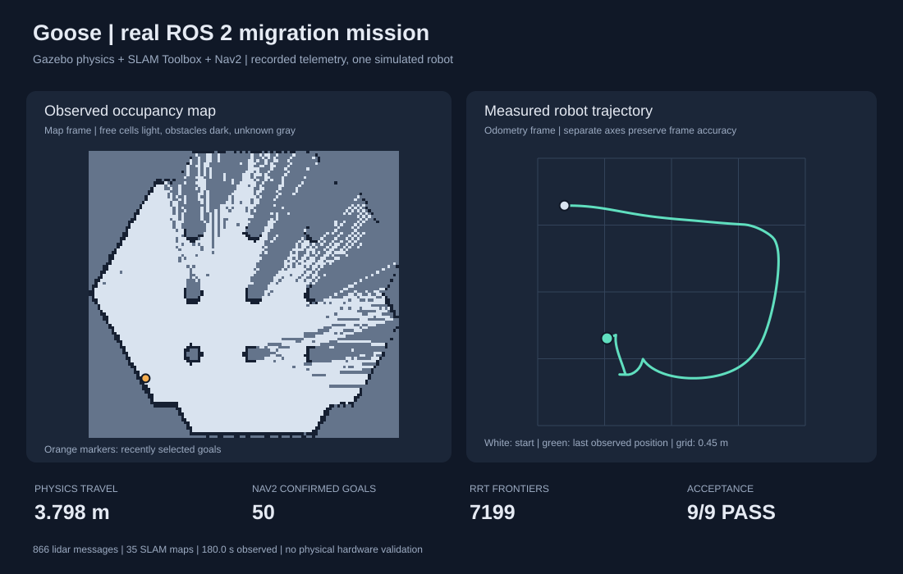

# Completed ROS engineering engagement

`GS-1004` completed Goose's live Naïve workflow: source intake, assessment, executable proposal, synthetic approval, original baseline, frozen verification, implementation, two bounded code repairs, independent checks, delivery, synthetic acceptance, invoice and follow-up. The local commerce demonstration then settled its $1,250 TEST invoice and exercised support, transactional receipts and delivery-integrity monitoring. No external email or real payment occurred.

The [job record](ros-workflow-live.json) contains sessions, costs, four verification attempts, approvals, interventions and important events. The [unchanged delivery ZIP](deliveries/GS-1004.zip) contains the generated implementation, frozen contract, reports, mission graphic, map, diff, provenance and quality note. Its SHA256 is `49cdff681c66ed50dc9ded99e09608083680cb125dd1514a2d3d753dff641307`.

## What the independent checks established

- Final engagement verification: **14/14**, including **111/111** algorithm checks and **9/9** Gazebo mission checks.
- Physics travel: **3.798 metres**, with real lidar, SLAM maps, transforms and frontier messages.
- Nav2 confirmed **50 successful request UUIDs** through its own GetResult service. The candidate's dispatch log contains **three distinct destinations**; it repeatedly requests the last one. These are not 50 distinct exploration destinations.
- Frozen verifier: v7, SHA256 `a2bad3e0113dd0b3e97396795666c10174be7a7109fb436577ff99a7e15635ab`.
- Final candidate digest: `da4f6a07a40b32ae97f941760d1228bdf659daa19f6a1df76a563e0bb31783fa`.

The [simulation](ros-workflow/robotics-simulation.json), [algorithm report](ros-workflow/robotics-verification.json), [quality observation](ros-workflow/robotics-quality.json) and [commerce trace](ros-workflow/commerce.json) retain the detailed evidence.



Repeated-target suppression and sustained exploration progress remain follow-up work. The customer workspace displays that limitation prominently, and a TEST change request records it pending fresh source and a new proposal. The original contract establishes bounded navigation and algorithm behavior, not complete exploration coverage, ROS 1 simulator equivalence or physical robot safety.

## Decisions and interventions

The first candidate compiled and passed algorithm checks but failed simulation. Naïve diagnosed and repaired a missing `tf2_geometry_msgs` registration and an unsupported `rclpy.on_shutdown` call. Once that path worked, the next run exposed two writes to a nonexistent `PointArray.header`; Naïve removed those writes in a second repair. Each repair changed only selected files, with all other component hashes retained. The two repair plans and coding tasks cost **$0.203569** in metered Naïve usage.

The initial observer counted candidate-reported completions too heavily. Its correction to independently query Nav2 was an explicit TEST verifier amendment. The old vault and failed attempt remained intact, the original baseline was replayed twice, and the same candidate was verified again before repair. Preliminary standalone evidence is labelled separately under `robotics/evidence/v3-preliminary/`.

Packaging initially selected verification attempt one because the packaging stage has a single execution key. The integrity guard correctly refused that stale failed result. The product now selects the job's current verified attempt; a regression test executes the stage dispatcher and inspects the resulting ZIP. The successful retry retained the exact candidate and acceptance hashes.

Five founder interventions total **12 recorded minutes** for planning/runtime recovery, the verifier correction and packaging recovery. These minutes describe engagement interventions, not all development labour used to build Goose. Total engagement cost was **$2.104620**: **$2.089340** metered by Naïve and **$0.015280** of labelled local compute estimates. TEST invoice value is not revenue or proof of commercial margin.

## Reproduce the delivered candidate

From the Goose repository, with the image built as described in [the robotics guide](../../robotics/README.md):

```sh
delivery_dir="$(mktemp -d)"
unzip -q docs/evidence/deliveries/GS-1004.zip -d "$delivery_dir"
python3 robotics/run.py build --candidate "$delivery_dir/source"
python3 robotics/run.py verify --candidate "$delivery_dir/source"
python3 robotics/run.py simulate --candidate "$delivery_dir/source" --seconds 180
```

These commands execute the actual delivered code in isolated containers. `goose-ros2` in the acceptance contract is the application's adapter identifier; the standalone interface is `robotics/run.py`. Reproduction needs no Naïve generation call. Simulation is nondeterministic, so exact trajectories and request counts can differ while the recorded acceptance criteria remain the same.
