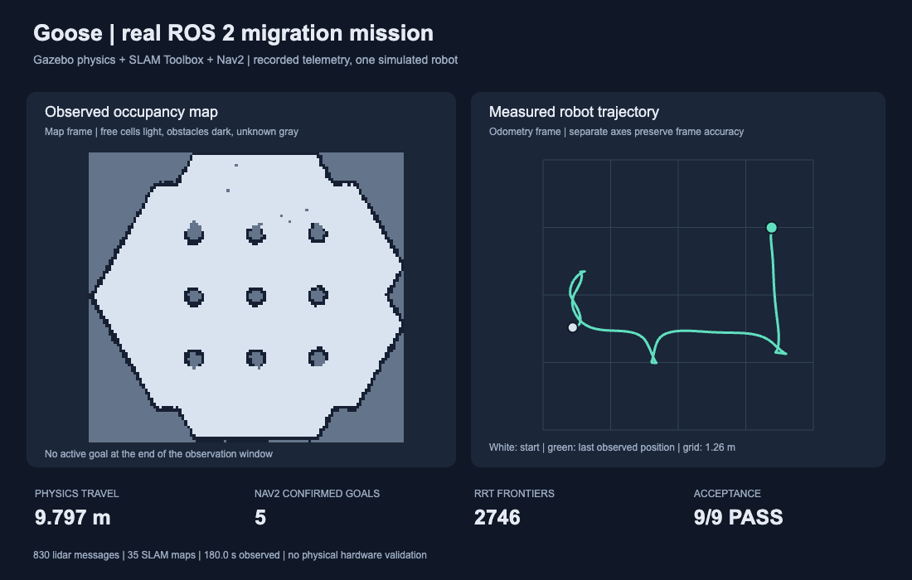

# Real ROS migration adapter

This adapter gives Goose a demanding, bounded engineering job: migrate the MIT
`hasauino/rrt_exploration` frontier exploration package from ROS 1 to ROS 2 Jazzy,
preserve its core algorithms, and run the result against an existing Gazebo,
SLAM Toolbox, and Nav2 TurtleBot3 stack. Goose remains a general engineering
company. Robotics is one supported workspace contract, not the company scope.

The submitted example is pinned to upstream commit
`3ec97a78c09f0382364e4dd0d4b4b9e0096a4790`. Original files and their hashes live
in `source/manifest.json`; the original MIT license is retained. The source
archive consists of the contents of `source/rrt_exploration/`.

## What runs

1. `baseline` verifies the original source hashes and executes its pure Python
   algorithms with explicit Python 2 integer-division compatibility.
2. The production `migrateRobotWithAgent` adapter delegates five bounded parts
   to live Naive agents through the normal Goose budget and file ledger.
   Each part has a recorded session, cost, and generated-file hash. The host
   packages the result; independent verification determines whether it works.
3. `build` syntax-checks Python and builds the actual generated C++ detector,
   custom message, Python filter/assigner, and launch package using colcon.
4. `verify` executes 111 independent source-parity, bounds, goal-selection,
   and negative-control checks. Candidate functions run in a separate capped,
   read-only Docker container. Expected answers and the report writer remain
   on the host; the candidate cannot write its own verification report.
5. `simulate` starts the official Nav2 TurtleBot3 Gazebo sandbox, SLAM, and
   navigation. A trusted observer waits for active Nav2 before starting the
   migrated package in another container. It records actual clock, lidar,
   map, odometry, frontier, and assignment-status messages. A passing run
   requires physical simulated motion and a successful Nav2 GetResult response
   for a unique goal UUID. The observer queries that service independently.

The observer and candidate communicate over a dedicated Docker internal bridge
with no external network route. Their filesystems and IPC namespaces stay
separate. Fast DDS uses UDPv4 because its default shared-memory preference
cannot cross private IPC namespaces. This
follows the [Fast DDS transport documentation](https://fast-dds.docs.eprosima.com/en/stable/fastdds/env_vars/env_vars.html).

## Reproduce

Docker must be running, with at least 6 GiB available memory. The source replay
only needs Python 3; build, target verification, and simulation need Docker.

```sh
docker build -t goose-robotics:jazzy -f robotics/Dockerfile robotics
python3 robotics/run.py baseline --candidate robotics/source/rrt_exploration
# Upload that source archive to Goose as a workspace job to generate a candidate.
python3 robotics/run.py build --candidate /absolute/path/to/candidate
python3 robotics/run.py verify --candidate /absolute/path/to/candidate
python3 robotics/run.py simulate --candidate /absolute/path/to/candidate --seconds 180
```

The production workspace contract exposes the trusted commands `goose-ros2
baseline`, `build`, `verify`, and `simulate`. The application supplies the actual
isolated job directory; a submitted repository cannot choose a different
candidate or replace this adapter. The root contract allows 600 seconds for
build and 360 seconds for simulation. Target source remains subject to the
normal acceptance and repair boundaries.

Reports go to `var/robotics/jobs/<candidate-path-sha256-prefix>/`. The standalone
diagnostic fixture in `generated/` uses `var/robotics/runtime/` instead.
`build.json`, `verification.json`, and `simulation.json` include candidate file
hashes and observed results. Simulation also writes `observed-map.json` and
separate simulator/candidate logs. Reports are removed before reruns; nonzero
execution, wrong nonce, missing checks, or changed source cannot yield a pass.

`verification-manifest.json` freezes acceptance code before generation. A
verification change requires a new manifest version and new recorded evidence.
The application additionally freezes that manifest in each job vault.

## Evidence boundaries

- ROS 1 baseline evidence is source algorithm replay. The old ROS 1 runtime and
  simulator were not executed. The comparison does not prove full ROS 1 stack
  equivalence.
- Simulation covers one differential-drive robot and one world. There is no
  physical robot validation, collision certification, or full exploration
  coverage claim. Gazebo and Nav2 are reused infrastructure.
- The ROS-specific baseline adapter accepts the pinned source fixture only.
  Other projects can use Goose's general workspace contract, but need an
  appropriate independent runtime and acceptance definition.
- Completion requires independent Nav2 GetResult responses. Candidate status
  remains supplementary telemetry. DDS messages are not cryptographically
  authenticated; this is not an adversarial robotics certification system.
- The Docker base image is pinned by digest. Apt packages are installed by the
  recipe and can change when rebuilt. Record the actual built image ID when
  presenting results; a recipe alone is not a bit-for-bit image guarantee.
- The checked-in `naive-port-parts.ts` and `naive-repair.ts` are diagnostic
  companions with their own transcripts. The full customer workflow calls
  `migration.ts` and records every part in the normal Goose job ledger.

## Recorded development run

The checked-in standalone fixture passed all 111 algorithm checks and all nine
simulation checks with verification manifest version 7. During 180 seconds of
observation, it travelled 9.797 m, completed five independently confirmed Nav2
goals, published 2,746 frontiers, and produced 830 lidar messages and 35 SLAM maps. The complete
report, candidate hashes, package versions, and recorded Naive provenance are
in `evidence/`. These are development fixture results, separate from the full
customer job ledger and its independently generated candidate.



The image is rendered from actual recorded occupancy and odometry data. The two
panels use separate coordinate frames. Rebuild it from portable evidence with:

```sh
python3 robotics/plot_mission.py robotics/evidence/simulation.json robotics/evidence/mission.svg
```

Five generation parts plus the recorded Naive code repair cost $0.606771.
Earlier unsuccessful monolithic generation adds $0.113092, for $0.719863 of
recorded Naive development spend. The agent repair fixed runtime parameter
declarations, Python indentation, and signed frontier status on ARM64. Failed
transport experiments and their resolution are summarized in
`evidence/experiments.json`. Version 3 is preserved as preliminary because its
completion check used the candidate's counter. Versions 4 and 5 failed closed
on ROS metadata compatibility, and version 6 was cancelled before the complete
host wrapper was frozen. Version 7 reran the same candidate with the stronger
Nav2 service check and recorded five successful result UUIDs. Failed or
preliminary runs remain separately identified.

## Harness checks

```sh
python3 -m pytest -q tests/robotics
GOOSE_TEST_DOCKER=1 python3 -m pytest -q tests/robotics
```

The Docker-enabled test executes a deliberately malicious candidate that tries
to manufacture a successful report. The host verifier must reject it.
